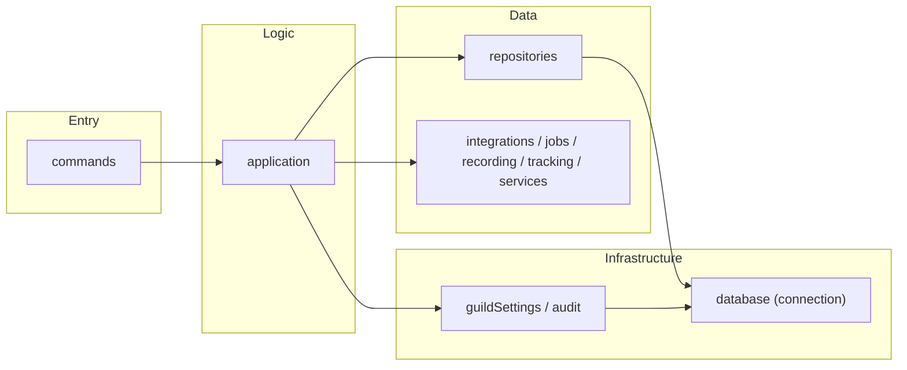
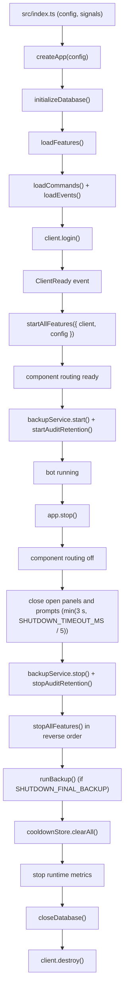

# Project Structure

The project uses feature-based architecture. Each feature owns its command entrypoints, supporting runtime code, and feature-specific repository layer under `src/features/`.

## Structure

```text
.
├── scripts/                 # Repo workflow shell scripts
└── src/
    ├── index.ts             # Process entry point: config, signals, crash reporting
    ├── client.ts            # Discord client configuration (keep-alive REST agent, cache limits)
    ├── app/
    │   ├── composition.ts   # Composition root: what the bot is made of, and in what order
    │   ├── compileCache.ts  # V8 compile cache under DATA_DIR (production)
    │   ├── processHandlers.ts
    │   └── interactions/
    │       ├── commandRegistry.ts   # Feature command discovery + deployment payload
    │       └── interactionRouter.ts # Slash commands, autocomplete, components, unclaimed forms
    ├── app-scripts/         # TypeScript maintenance scripts
    ├── config/
    │   ├── env.ts           # Environment variables
    │   ├── schema.ts        # Parsing and validation (STATS_TIMEZONE, paths, limits)
    │   ├── constants.ts     # Internal constants (AUDIO, MONITORING, BOT_INFO)
    │   └── index.ts
    ├── features/
    │   ├── index.ts         # Feature auto-discovery, FeatureContext, startAllFeatures/stopAllFeatures
    │   ├── __tests__/       # Feature registry tests
    │   ├── voice/
    │   │   ├── index.ts     # Feature lifecycle (name, start, stop)
    │   │   ├── commands/    # /voice, /tts
    │   │   ├── application/ # Record, status panel, auto-join policy, onboarding, opt-out button, TTS
    │   │   ├── events/      # voiceStateUpdate, guildCreate (welcome), voice channel status, TTS messages
    │   │   ├── recording/   # Connection manager, per-channel ring buffer, chunk placer, recording service
    │   │   ├── tts/         # VOICEVOX client, synthesis scheduler, session manager, name cache
    │   │   ├── repositories/ # Auto-join settings, exclusions, TTS dictionary and voices
    │   │   ├── jobs/        # Memory monitor, recording file cleanup
    │   │   └── __tests__/
    │   ├── admin/
    │   │   ├── index.ts
    │   │   ├── commands/    # /admin, /owner
    │   │   ├── application/ # Settings and system panels, roles, broadcasts, backups
    │   │   ├── repositories/ # DB stats (real SQL)
    │   │   └── __tests__/
    │   ├── general/
    │   │   ├── index.ts
    │   │   ├── commands/
    │   │   └── application/ # help (helpIndex.ts: memoized catalog + search; visibility.ts), about, ping
    │   ├── notification/
    │   │   ├── index.ts
    │   │   ├── commands/
    │   │   ├── application/ # Panel, stats, VC digest, channel checks, settings summary
    │   │   ├── events/
    │   │   ├── repositories/
    │   │   ├── stats/       # Stats calendar (STATS_TIMEZONE day keys) and periods
    │   │   ├── tracking/
    │   │   └── __tests__/
    │   └── community/
    │       ├── index.ts
    │       ├── commands/
    │       ├── application/ # Roulette (with re-roll buttons)
    │       ├── poll/        # Native-poll command, its form, and the message pointer it stores
    │       └── __tests__/
    ├── shared/
    │   ├── help/
    │   │   ├── catalog.ts   # Shared help catalog types/state
    │   │   └── __tests__/   # Catalog vs. command definition consistency
    │   ├── interactions/    # Persistent component handlers, live-component tracking, error ids
    │   ├── settingsSummary/ # Registry each feature adds its part of /admin settings view to
    │   ├── types/           # Cross-feature type definitions
    │   └── utils/           # Cross-feature utilities (panel, confirm, commandMentions, discord, embed, ...)
    ├── events/              # Core client/interaction events
    ├── handlers/            # Auto-loaders for commands and events; command sync (hash in DATA_DIR)
    ├── middleware/
    │   ├── index.ts         # Middleware pipeline (runMiddleware)
    │   ├── permissions.ts
    │   ├── types.ts
    │   ├── cooldown/        # Cooldown middleware + store (per subcommand path)
    │   │   ├── cooldownMiddleware.ts
    │   │   ├── cooldownStore.ts
    │   │   ├── index.ts
    │   │   └── __tests__/
    │   └── __tests__/       # Middleware tests
    ├── infrastructure/
    │   ├── database/
    │   │   ├── connection.ts  # DB connection, pragma, close ONLY
    │   │   ├── transaction.ts # runTransaction
    │   │   ├── index.ts       # Barrel re-export
    │   │   └── migrations/    # DDL definitions, 001_steam.ts … 012_query_indexes.ts
    │   │       └── index.ts   # initializeDatabase()
    │   ├── guildSettings/   # Sole owner of guild_settings (language, audit/announcement channel, voice auto-join)
    │   │   ├── index.ts
    │   │   └── __tests__/
    │   ├── audit/           # Audit log storage, delivery and retention
    │   │   ├── index.ts
    │   │   ├── auditRepository.ts  # Owns audit_logs
    │   │   ├── format.ts
    │   │   └── __tests__/
    │   ├── backup/          # Scheduled DB backups (snapshot in a worker thread)
    │   │   ├── index.ts
    │   │   ├── snapshot.ts
    │   │   ├── storage/
    │   │   └── __tests__/
    │   ├── health/          # Health check service
    │   │   ├── index.ts
    │   │   └── __tests__/
    │   └── metrics/         # In-memory metrics, event-loop delay, time to acknowledge
    │       ├── index.ts
    │       └── __tests__/
    └── locales/             # i18n (en, ja), formatters (format.ts), server language (guildLocale.ts)
```

## Feature Rules

- Every feature must export `name`, `start(client)`, and `stop()` from its `index.ts`.
- Features are **auto-discovered**; no manual registration is needed. `loadFeatures()` scans feature directories and builds the registry.
- `startAllFeatures(client)` and `stopAllFeatures()` handle per-feature **error isolation** and **health status**. A failing feature does not block others.
- `start(client)` is invoked only after the Discord `ready` event, so feature startup may rely on `client.isReady()` and warmed guild caches.
- `commands/` must contain only public slash command definition files that are auto-loaded by `src/handlers/commandHandler.ts`.
- Internal command logic should live in `application/`.
- Feature-specific persistence access should live in that feature's `repositories/`. Repositories contain **actual SQL queries**, not thin wrappers.
- Prefer explicit supporting folder names such as `integrations/`, `jobs/`, `recording/`, `tracking/`, and feature-owned internal modules like `community/poll/`.
- `commands/` files delegate to `application/`; they must not import `repositories/` or `infrastructure/` directly.
- Features never import each other. Anything two features need belongs in `infrastructure/` or `shared/`.
- `src/infrastructure/` is reserved for truly shared runtime infrastructure, not feature-owned business logic. State that several features read - such as `guild_settings` - is owned here, not by whichever feature happens to provide its UI.
- `src/shared/` contains cross-feature utilities, types, and shared registries: the help catalog, persistent component handlers (`shared/interactions`) and the settings overview (`shared/settingsSummary`). A feature registers into them in `start()` and removes itself in `stop()`, so features stay unaware of each other.
- Feature lifecycle hooks take a `FeatureContext` (`{ client, config }`). A feature must not import `env` to start itself.
- Nothing is constructed at import time. A module that needs configuration reads it when it is used or when its owner builds it.
- These rules are enforced by `src/__tests__/architecture.test.ts`, not just documented.

## Layer Architecture

Request flow from slash command to persistence:



- **commands**: Slash command definitions; delegate to application layer.
- **application**: Command/business logic handlers; orchestrate repositories and supporting runtime folders.
- **repositories**: Database access with real SQL; use `runTransaction()` for multi-table writes.
- **supporting runtime folders**: Feature-owned integrations, background jobs, trackers, recorders, or stateful helpers. Prefer explicit names such as `jobs/`, `recording/`, or `tracking/` over a generic `services/` directory.
- **shared infrastructure**: Cross-feature state and services with their own tables — `guildSettings` (`guild_settings`) and `audit` (`audit_logs`). Features use them; they never depend on a feature.
- **database**: Pure infrastructure under `src/infrastructure/database/`—connection, pragma, transactions, migrations only.

## Database Layer

- `infrastructure/database/` is **pure infrastructure**: connection management, `runTransaction()`, and migrations.
- No business logic or feature-specific queries live here. All SQL lives in feature `repositories/`.
- Migrations are numbered DDL files (`001_steam.ts` … `012_query_indexes.ts`) applied by `initializeDatabase()`. They re-run on every boot, so a migration that adds a column checks `PRAGMA table_info` first, and two files with the same number stop the boot. The Steam feature has been removed; migrations 001 and 002 are kept untouched for a clean upgrade path, and `005_drop_steam.ts` drops the legacy Steam tables on existing databases. See [`database.md`](database.md).

## Interactions

- Slash commands and events are auto-discovered from `features/*/commands/` and `features/*/events/`.
- Interactive panels use `runComponentPanel()` from `src/shared/utils/panel.ts`, which owns the reply/collect/re-render/expire lifecycle. A panel supplies `render`, `renderDisabled`, and `onComponent`. Yes/no prompts use `awaitConfirmationResult()` from `src/shared/utils/confirm.ts`. Both register their message as live, so the router leaves its clicks to them and shutdown can close them visibly.
- Buttons that must keep working after a restart (the "exclude this VC" button on voice notices, `voice-optout:`) are registered by customId prefix with `registerComponentHandler()` from `src/shared/interactions` in the owning feature's `start()`, and re-check permissions on every click.
- Buttons and selects reach the router in this order: a live collector (open panel or prompt) keeps them; then a registered persistent handler; then a message whose panel or prompt settled in the last 10 seconds is acknowledged quietly (its owner is replacing it); anything else gets the fallback, after a 1.5 s grace for messages sent by this process. Once component routing is ready, the fallback greys the components out and names the command to run again. Before every feature has started, and from the first shutdown step, it only replies "the bot is restarting, try again" and never edits the message, because a persistent button's handler may simply not be registered yet.
- A submitted form (modal) is answered by whoever opened it (`awaitModalSubmit`). If nothing has answered it after the same grace period - the bot restarted while it was open, or it stayed open too long - the router tells the user privately that the form expired and what they typed was not saved.
- Slash command names in replies are written with `commandMention()` (`src/shared/utils/commandMentions.ts`), which renders a clickable `</voice record:id>` once the registered ids are known.
- Errors shown to users carry a short error id (`createErrorId()`), logged next to the stack, so a report can be matched to the log.

## Middleware

- Cooldown logic lives in `middleware/cooldown/` (cooldownMiddleware + cooldownStore). Cooldowns are per user and per full subcommand path; `options.cooldowns` sets them per path prefix (the longest match wins), and a handler that turns a request down before doing any work calls `releaseCooldown(interaction)`.
- `options.permissions` are checked against the member's server-wide permissions (roles and ownership); a channel overwrite does not count.
- `runMiddleware()` in `middleware/index.ts` runs the pipeline (permissions, cooldown, etc.) before command execution. A refusal is a private warning, not an error.

## Tests

- Tests are **colocated** with features: each feature has its own `__tests__/` directory.
- Shared test helpers live in `src/__tests__/helpers/`.
- Shared utility tests may live under `src/shared/**/__tests__/`.
- Middleware tests under `middleware/__tests__/` and `middleware/cooldown/__tests__/`.
- Infrastructure tests under `infrastructure/<service>/__tests__/`.

## Composition Root

`src/app/composition.ts` is the single place the running bot is assembled.
`createApp(config, deps)` builds the object graph and returns `start()` and
`stop()`; `src/index.ts` keeps only what belongs to the process — reading
configuration, signal handlers, and last-resort crash reporting. A test
enforces that split (`src/__tests__/architecture.test.ts`).

`deps` defaults to the real collaborators and can be replaced wholesale, so
`src/app/__tests__/composition.test.ts` drives the real startup and shutdown
sequence with fakes instead of mocking module paths. Order is a correctness
property here — the database opens before anything queries it, features start
only after the gateway is ready, and the final backup runs after features
have written their last rows but while the connection is still open — so it
is asserted, not assumed.

Features are started with a `FeatureContext` (`{ client, config }`) rather
than importing `env` for themselves, and nothing is constructed at import
time: the voice jobs are built from the config their feature is handed, and
services that must stay module-level (`backupService`,
`connectionManager`) read configuration on first use.

**What is deliberately not injected:** `config` and the database connection.
Both are process-wide resources with an explicit lifecycle (`loadConfig`,
`closeDatabase`), and their consumers are reached through Discord interaction
handlers whose signature the library fixes. Threading them down would mean a
module-level context holder set during startup — the same global with extra
steps and a temporal coupling on top. Tests override both by mocking
`config/index.js` and `database/connection.js`.

## Lifecycle

Startup and shutdown flow:



Every shutdown step runs even if an earlier one throws, so a feature that
hangs cannot leave the database open.

The final backup runs after `stopAllFeatures()`, so rows that features write
on the way out (the notification feature closes open VC sessions) are in it.
Stopping the backup service first only cancels its schedule; `runBackup()`
still works afterwards.

Component routing is marked ready only after every feature has started (and
registered its persistent buttons), and switched off as the first shutdown
step, before features unregister them; see [Interactions](#interactions).

The voice feature also hooks the connection manager before each disconnect
(`onBeforeDisconnect`), so the bot clears the voice channel status it set
while it is still in the channel.

## Scripts

- `src/app-scripts/`: TypeScript scripts that operate on the application or Discord state.
- `scripts/` at the repository root: shell scripts for repo workflow such as validation and git hooks.

[← Back to README](../README.md)
