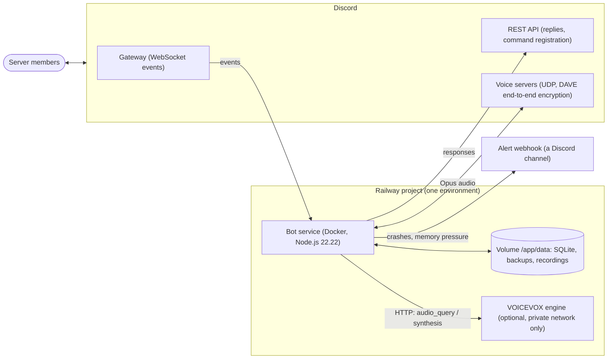
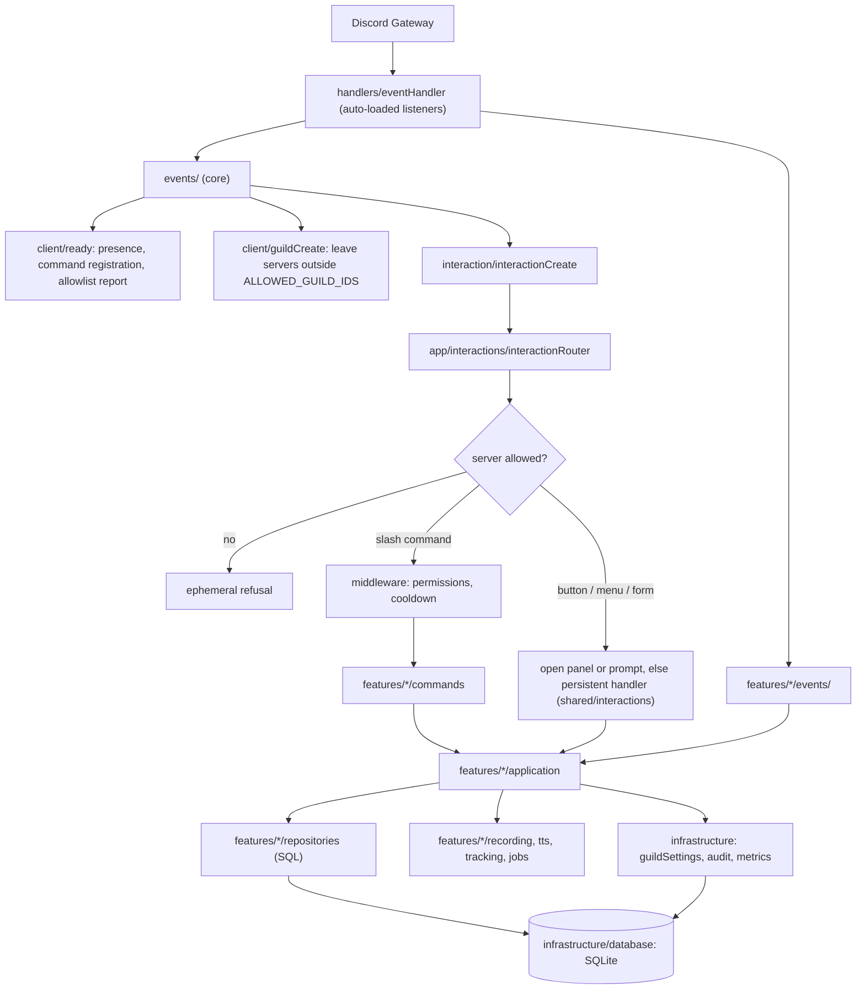
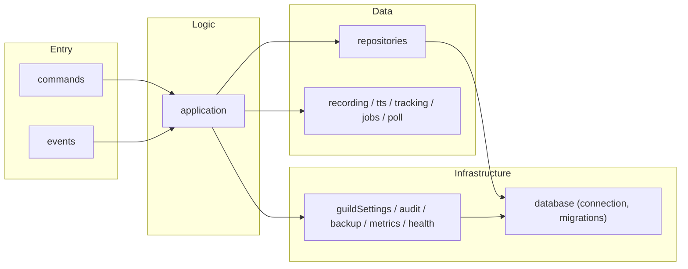
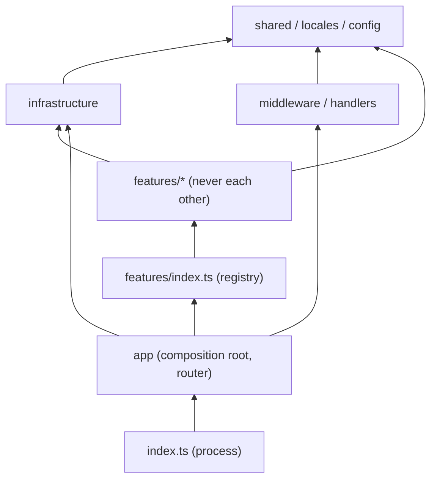
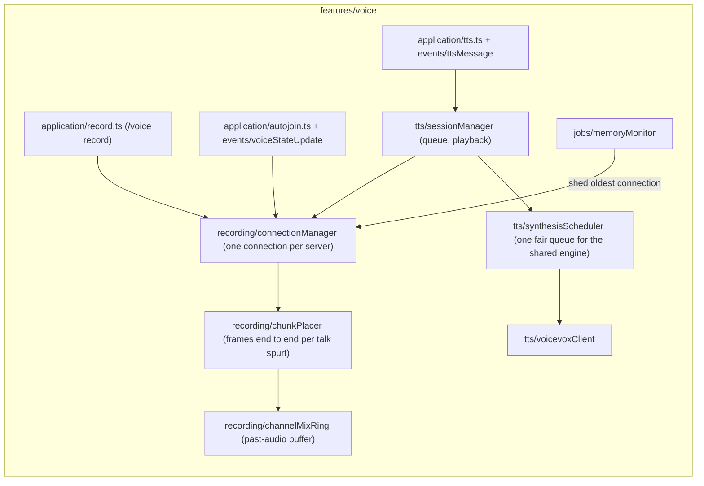

# Architecture

The bot is one Node.js process built as a **modular monolith**: features are
self-contained folders under `src/features/`, assembled by a single
composition root, and kept apart by dependency rules that a test enforces
(`src/__tests__/architecture.test.ts`). This page goes from the outside in:
the system around the bot, the process, a feature, and the files on disk.

How the bot is deployed, released and run in staging and production is in
[operations.md](operations.md).

## System context



- **Gateway intents**: `Guilds`, `GuildVoiceStates`, `GuildMembers`
  (privileged), and - only when `VOICEVOX_URL` is set - `GuildMessages` and
  `MessageContent` (privileged) for text-to-speech.
- **State** lives in one SQLite file on the volume. There is no other database,
  cache server, or queue: one process owns everything, which keeps shutdown,
  backups and migrations simple. It also means one replica per environment -
  see [Scaling limits](#scaling-limits).
- **VOICEVOX** is reachable only over Railway private networking and is never
  exposed to the internet.

## Inside the process

Every Discord event enters through the auto-loaded event listeners. Every
interaction passes one router: slash commands then go through one middleware
pipeline before reaching a feature, and buttons, menus and forms go to the
panel, prompt or persistent handler that owns them. Feature events (voice
state, messages) go straight to the feature that registered them.



### Interactions

- Slash commands and events are auto-discovered from `features/*/commands/`
  and `features/*/events/`.
- Interactive panels use `runComponentPanel()` from
  `src/shared/utils/panel.ts`, which owns the reply/collect/re-render/expire
  lifecycle. A panel supplies `render`, `renderDisabled`, and `onComponent`.
  Yes/no prompts use `awaitConfirmationResult()` from
  `src/shared/utils/confirm.ts`. Both register their message as live, so the
  router leaves its clicks to them and shutdown can close them visibly.
- Buttons that must keep working after a restart (the "exclude this VC"
  button on voice notices, `voice-optout:`) are registered by customId prefix
  with `registerComponentHandler()` from `src/shared/interactions` in the
  owning feature's `start()`, and re-check permissions on every click.
- Buttons and selects reach the router in this order: a live collector (open
  panel or prompt) keeps them; then a registered persistent handler; then a
  message whose panel or prompt settled in the last 10 seconds is
  acknowledged quietly (its owner is replacing it); anything else gets the
  fallback, after a 1.5 s grace for messages sent by this process. Once
  component routing is ready, the fallback greys the components out and
  names the command to run again. Before every feature has started, and from
  the first shutdown step, it only replies "the bot is restarting, try again"
  and never edits the message, because a persistent button's handler may
  simply not be registered yet.
- A submitted form (modal) is answered by whoever opened it
  (`awaitModalSubmit`). If nothing has answered it after the same grace
  period - the bot restarted while it was open, or it stayed open too long -
  the router tells the user privately that the form expired and what they
  typed was not saved.
- Slash command names in replies are written with `commandMention()`
  (`src/shared/utils/commandMentions.ts`), which renders a clickable
  `</voice record:id>` once the registered ids are known.
- Errors shown to users carry a short error id (`createErrorId()`), logged
  next to the stack, so a report can be matched to the log.

### Middleware

- Cooldown logic lives in `middleware/cooldown/` (cooldownMiddleware +
  cooldownStore). Cooldowns are per user and per full subcommand path;
  `options.cooldowns` sets them per path prefix (the longest match wins), and
  a handler that turns a request down before doing any work calls
  `releaseCooldown(interaction)`.
- `options.permissions` are checked against the member's server-wide
  permissions (roles and ownership); a channel overwrite does not count.
- `runMiddleware()` in `middleware/index.ts` runs the pipeline (permissions,
  cooldown, etc.) before command execution. A refusal is a private warning,
  not an error.

## Layers



- **commands**: Slash command definitions. They delegate to `application/` and
  never import `repositories/` or `infrastructure/`.
- **events**: Gateway listeners a feature owns (for example
  `voiceStateUpdate`). They call into `application/` too.
- **application**: The use cases - what a command or event does. Orchestrates
  repositories and the feature's runtime folders.
- **repositories**: Real SQL against the feature's own tables. Multi-table
  writes go through `runTransaction()`.
- **runtime folders**: Stateful, feature-owned machinery with explicit names -
  `recording/`, `tts/`, `tracking/`, `jobs/`, `poll/` - rather than a generic
  `services/`.
- **shared infrastructure**: State and services several features use, with
  their own tables - `guildSettings` owns `guild_settings`, `audit` owns
  `audit_logs`. Features use them; they never depend on a feature.
- **database**: Connection, pragmas, transactions and migrations only. No
  feature queries.

### Dependency rules



Arrows point from the importer to what it may import. Each rule below is a
test case in `src/__tests__/architecture.test.ts`, so breaking one fails CI:

- `infrastructure`, `shared`, `locales`, `middleware`, `config` and `handlers`
  never import a feature.
- `app` reaches features only through the registry (`features/index.ts`).
- Features never import each other. Anything two features need moves down to
  `infrastructure/` or `shared/`.
- `src/index.ts` gets the bot only from `app/composition.ts`.
- `commands/` never import `repositories/` or `infrastructure/`.
- Only `infrastructure/guildSettings` (and the database layer) writes SQL for
  `guild_settings`.
- Test files live in `__tests__/` directories, so none is compiled into
  `dist/`.

## Features

| Feature        | Commands           | Owns                                                                                                                           |
| -------------- | ------------------ | ------------------------------------------------------------------------------------------------------------------------------ |
| `admin`        | `/admin`, `/owner` | Server settings panel and overview, role tools, broadcasts, owner system panel, backups, DB statistics                         |
| `community`    | `/community`       | Native Discord polls (`poll/`) with their creation form, VC roulette with re-roll                                              |
| `general`      | `/general`         | Help (catalog index with search, built from command definitions), about, ping                                                  |
| `notification` | `/notification`    | VC join/leave and member-join notices, VC time tracking, daily stats on the `STATS_TIMEZONE` calendar                          |
| `voice`        | `/voice`, `/tts`   | The voice connection, past-audio recording, auto-join with onboarding, opt-out button and voice channel status, text-to-speech |

Every feature exports `name`, `start(context)` and `stop()` from its
`index.ts`, and is discovered automatically:

- `loadFeatures()` scans `src/features/*/index.ts`; there is no manual
  registration.
- `startAllFeatures({ client, config })` runs after the gateway is ready, so a
  feature's `start` may rely on warmed guild caches. A feature that fails to
  start is isolated and reported in health status; the others still start.
- Features receive configuration through `FeatureContext` and must not import
  `env` to start themselves. Nothing is constructed at import time.
- `commands/` holds only the public slash command files the command handler
  auto-loads; internal logic lives in `application/`.
- Features meet only in `shared/` registries: the help catalog, persistent
  component handlers (`shared/interactions`) and the settings overview
  (`shared/settingsSummary`). A feature registers into them in `start()` and
  removes itself in `stop()`, so features stay unaware of each other.

### Why text-to-speech lives inside `voice`

Discord lets a bot hold **one voice connection per server**. Recording,
auto-join and text-to-speech all need that connection, so exactly one module
must own it - `voice/recording/connectionManager.ts` - and arbitrate between
them: whether a join may buffer audio, who may disconnect, which connection
to shed under memory pressure.



A separate `tts` feature would have to import `connectionManager` from
`voice`, which "features never import each other" forbids for good reason:
the two would change in lockstep anyway. Keeping them together is the honest
boundary. If a third, unrelated consumer of the connection appears, move the
connection manager to `infrastructure/voice/` and split the features along it.

## Lifecycle

```mermaid
flowchart TD
  main["src/index.ts: loadConfig, installProcessHandlers"] --> createApp["createApp(config)"]
  createApp --> initDb["initializeDatabase(): run migrations"]
  initDb --> loadFeatures["loadFeatures()"]
  loadFeatures --> loadDiscord["loadCommands() + loadEvents()"]
  loadDiscord --> metricsStart["startRuntimeMetrics()"]
  metricsStart --> login["client.login()"]
  login --> ready["ClientReady"]
  ready --> featureStart["startAllFeatures({ client, config })"]
  featureStart --> routingReady["component routing ready"]
  routingReady --> backupStart["backupService.start() + startAuditRetention()"]
  backupStart --> running["running"]
  running -- "SIGTERM / SIGINT / uncaught error" --> shutdown["app.stop()"]
  shutdown --> routingOff["component routing off"]
  routingOff --> liveComponents["close open panels and prompts (min(3 s, SHUTDOWN_TIMEOUT_MS / 5))"]
  liveComponents --> backupStop["backupService.stop() + stopAuditRetention()"]
  backupStop --> featureStop["stopAllFeatures() in reverse order"]
  featureStop --> finalBackup["runBackup() if SHUTDOWN_FINAL_BACKUP"]
  finalBackup --> cooldowns["cooldownStore.clearAll()"]
  cooldowns --> metricsStop["stopRuntimeMetrics()"]
  metricsStop --> closeDb["closeDatabase()"]
  closeDb --> destroyClient["client.destroy()"]
```



Every shutdown step runs even if an earlier one throws, so a feature that
hangs cannot leave the database open. `app/processHandlers.ts` bounds the
whole shutdown by `SHUTDOWN_TIMEOUT_MS` and exits non-zero after a crash so
Railway's `ON_FAILURE` policy restarts the bot.

The final backup runs after `stopAllFeatures()`, so rows that features write
on the way out (the notification feature closes open VC sessions) are in it.
Stopping the backup service first only cancels its schedule; `runBackup()`
still works afterwards.

Component routing is marked ready only after every feature has started (and
registered its persistent buttons), and switched off as the first shutdown
step, before features unregister them; see [Interactions](#interactions).

The voice feature also hooks the connection manager before each disconnect
(`onBeforeDisconnect`), so the bot clears the voice channel status it set
while it is still in the channel.

## Composition root

`src/app/composition.ts` is the single place the running bot is assembled.
`createApp(config, deps)` builds the object graph and returns `start()` and
`stop()`; `src/index.ts` keeps only what belongs to the process - reading
configuration, signal handlers, and last-resort crash reporting. A test
enforces that split (`src/__tests__/architecture.test.ts`).

`deps` defaults to the real collaborators and can be replaced wholesale, so
`src/app/__tests__/composition.test.ts` drives the real startup and shutdown
sequence with fakes instead of mocking module paths. Order is a correctness
property here - the database opens before anything queries it, features start
only after the gateway is ready, and the final backup runs after features
have written their last rows but while the connection is still open - so it
is asserted, not assumed.

Features are started with a `FeatureContext` (`{ client, config }`) rather
than importing `env` for themselves, and nothing is constructed at import
time: the voice jobs are built from the config their feature is handed, and
services that must stay module-level (`backupService`,
`connectionManager`) read configuration on first use.

**What is deliberately not injected:** `config` and the database connection.
Both are process-wide resources with an explicit lifecycle (`loadConfig`,
`closeDatabase`), and their consumers are reached through Discord interaction
handlers whose signature the library fixes. Threading them down would mean a
module-level context holder set during startup - the same global with extra
steps and a temporal coupling on top. Tests override both by mocking
`config/index.js` and `database/connection.js`.

## Database

- `infrastructure/database/` is pure infrastructure: connection management,
  `runTransaction()`, and migrations. All feature SQL lives in that feature's
  `repositories/` (or its runtime folder, such as `community/poll/`).
- Migrations are numbered files (`001_steam.ts` … `012_query_indexes.ts`)
  applied by `initializeDatabase()` on **every boot**, so each one must be
  safe to re-run against a database it has already migrated: a column is
  added only after checking `PRAGMA table_info`, and a migration never
  rewrites a table that a later migration replaced. `migrationsReboot.test.ts`
  applies the full set three times to one database to keep that true. Two
  files with the same number stop the boot.
- Migrations 001 and 002 are kept untouched for a clean upgrade path from the
  removed Steam feature; `005_drop_steam.ts` drops those tables.

See [database.md](database.md) for the schema.

## Scaling limits

The design trades horizontal scale for simplicity, on purpose:

- **One replica per environment.** Two processes with the same token would
  both answer every interaction and fight over voice connections, and SQLite
  on a volume has a single writer. Keep Railway replicas at 1.
- **No sharding.** Discord requires sharding from 2,500 servers. Before the
  bot gets close, the in-memory state (cooldowns, voice sessions, metrics)
  has to move out of the process.
- **Voice memory scales per connection** (`AUDIO_BUFFER_DURATION × 0.27MB` per
  channel), capped by `MAX_CONCURRENT_VC_CONNECTIONS` and shed by the memory
  monitor. See [deployment.md](deployment.md).

## Directory structure

```text
.
├── .github/
│   ├── workflows/                # ci, codeql, dependency-audit, release
│   ├── pull_request_template.md  # Default PR checklist
│   ├── PULL_REQUEST_TEMPLATE/
│   │   └── release.md            # develop → main release PR
│   └── dependabot.yml
├── docs/                         # architecture, operations, deployment, database, development, quality
├── scripts/                      # validate.sh (CI parity), pre-push.sh (git hook), audit-all.sh
├── Dockerfile                    # Production image; pins the exact Node release
├── .nvmrc                        # The same Node version for CI and local development
├── railway.toml                  # Dockerfile build, start command, draining, restart policy
├── tsconfig.json                 # Build (excludes tests)
├── tsconfig.test.json            # Type-checks tests too
├── vitest.config.ts              # Tests + coverage floors
└── src/
    ├── index.ts                  # Process entry: config, signals, crash reporting
    ├── client.ts                 # Discord client: intents, keep-alive REST agent, cache limits
    ├── app/
    │   ├── composition.ts        # Composition root: what the bot is made of, in order
    │   ├── compileCache.ts       # V8 compile cache under DATA_DIR (production)
    │   ├── processHandlers.ts    # Signals, uncaught errors, bounded graceful shutdown
    │   └── interactions/
    │       ├── commandRegistry.ts    # Command discovery + registration payload
    │       └── interactionRouter.ts  # Slash commands, autocomplete, components, unclaimed forms
    ├── app-scripts/
    │   └── cleanup-commands.ts   # npm run cleanup-commands
    ├── config/
    │   ├── schema.ts             # Pure parsing + validation (STATS_TIMEZONE, paths, limits)
    │   ├── env.ts                # loadConfig(), lazy `env`
    │   ├── constants.ts          # Non-configurable constants (audio format, limits)
    │   └── index.ts
    ├── events/                   # Core gateway listeners
    │   ├── client/
    │   │   ├── ready.ts          # Presence, command registration, allowlist report
    │   │   └── guildCreate.ts    # Leave servers outside ALLOWED_GUILD_IDS
    │   └── interaction/
    │       └── interactionCreate.ts  # Hands interactions to the router
    ├── handlers/
    │   ├── commandHandler.ts     # Load commands, sync them with Discord (hash in DATA_DIR)
    │   └── eventHandler.ts       # Load core + feature events
    ├── middleware/
    │   ├── index.ts              # runMiddleware() pipeline
    │   ├── permissions.ts
    │   ├── types.ts
    │   └── cooldown/             # Cooldown middleware + store (per subcommand path)
    ├── features/
    │   ├── index.ts              # Registry: discovery, FeatureContext, start/stop all
    │   ├── admin/
    │   │   ├── commands/         # admin.ts (/admin), owner.ts (/owner)
    │   │   ├── application/      # settings and system panels, roles, broadcasts, backups
    │   │   └── repositories/     # databaseStatsRepository
    │   ├── community/
    │   │   ├── commands/         # community.ts (/community)
    │   │   ├── application/      # roulette (with re-roll buttons)
    │   │   └── poll/             # Native polls: command, creation form, pollRepository
    │   ├── general/
    │   │   ├── commands/         # general.ts (/general)
    │   │   └── application/      # help (helpIndex: memoized catalog + search), about, ping
    │   ├── notification/
    │   │   ├── commands/         # notification.ts (/notification)
    │   │   ├── application/      # panel, stats, voiceDigest, channel checks, settings summary
    │   │   ├── events/           # voiceNotification, memberJoinNotification
    │   │   ├── repositories/     # notificationChannel, voiceSession
    │   │   ├── stats/            # calendar (STATS_TIMEZONE day keys), periods
    │   │   └── tracking/         # voiceTracker
    │   └── voice/
    │       ├── commands/         # voice.ts (/voice), tts.ts (/tts)
    │       ├── application/      # record, status panel, autojoin, onboarding, optOut, tts …
    │       ├── events/           # voiceStateUpdate, guildCreate, voiceChannelStatus, ttsMessage
    │       ├── recording/        # connectionManager, channelMixRing, chunkPlacer, recordingService
    │       ├── tts/              # voicevoxClient, synthesisScheduler, sessionManager, nameAudioCache …
    │       ├── repositories/     # voiceSettings, tts
    │       └── jobs/             # fileCleanup, memoryMonitor
    ├── infrastructure/
    │   ├── database/
    │   │   ├── connection.ts     # Connection, pragmas, close
    │   │   ├── transaction.ts    # runTransaction()
    │   │   └── migrations/       # 001_steam … 012_query_indexes; index.ts = initializeDatabase()
    │   ├── guildSettings/        # Sole owner of guild_settings
    │   ├── audit/                # audit_logs: repository, format, retention
    │   ├── backup/               # Scheduled SQLite backups (snapshot in a worker thread, storage/)
    │   ├── health/               # Health status (memory, per-feature)
    │   └── metrics/              # In-memory counters, event-loop delay, time to acknowledge
    ├── shared/
    │   ├── help/catalog.ts       # Help catalog built from command definitions
    │   ├── interactions/         # Persistent component handlers, live components, error ids
    │   ├── settingsSummary/      # Registry each feature adds its part of the settings view to
    │   ├── types/                # Command, Event, middleware, voice types
    │   └── utils/                # logger, embed, panel, confirm, commandMentions, guildAllowlist, retry, alert …
    └── locales/                  # en, ja, formatters (format.ts), server language (guildLocale.ts)
```

Each feature also has an `index.ts` (its lifecycle) and a `__tests__/`
directory. Shared test helpers and cross-cutting tests - the architecture
rules, the all-commands smoke harness - live in `src/__tests__/`.

## Known debts

Not wrong enough to block work, but recorded so they get fixed on purpose
rather than copied:

- **`voice` is the largest feature.** That is the cost of the single
  connection owner described above, not an accident; split it only along the
  connection manager.

## Scripts

- `src/app-scripts/`: TypeScript scripts that operate on the application or
  Discord state (`npm run cleanup-commands`).
- `scripts/`: shell scripts for repository workflow - `validate.sh` mirrors CI,
  `pre-push.sh` is the git hook that runs it.

[← Back to README](../README.md)
