# Database

## Overview

The bot uses **SQLite** via [`better-sqlite3`](https://github.com/JoshuaWise/better-sqlite3) for data persistence.

- **Journal mode**: WAL (Write-Ahead Logging) for better concurrent read/write performance
- **Sync mode**: `synchronous = NORMAL`, set explicitly. In WAL mode this keeps the database consistent across a crash and syncs only at checkpoints, so a commit on the voice join/leave path never waits for an fsync
- **Planner statistics**: `closeDatabase()` runs `PRAGMA optimize` before closing, so statistics are refreshed at shutdown (up to about 100 ms the first time on a large database) and never on a timer
- **Path**: Configurable via `DATABASE_PATH` env var; defaults to `data/bot.db` (relative to `process.cwd()`)
- **Location**: On Railway, the database lives under `/app/data` when `DATABASE_PATH` is `data/bot.db` and the project root is `/app`

Feature code should prefer feature-local repositories under `src/features/<feature>/repositories/` instead of importing shared database modules directly. `src/infrastructure/database/` is reserved for DB bootstrap and shared primitives.

---

## Architecture

```
src/infrastructure/database/
├── connection.ts    # Singleton DB connection, pragmas, path resolution
├── transaction.ts  # runTransaction(fn) — synchronous transaction wrapper
├── migrations/
│   ├── index.ts             # Runs all migrations in order at startup
│   ├── 001_steam.ts …       # One file per migration, NNN_name.ts
│   └── 012_query_indexes.ts # Latest: see Migration System
└── index.ts        # Public exports

src/infrastructure/backup/
├── index.ts         # backupService: schedule, run, list, prune, restore
├── snapshot.ts      # Copies the database in a worker thread
└── storage/         # Where finished backups are kept (local directory)
```

- **connection.ts**: Creates the SQLite connection on first use, ensures the data directory exists, and sets `journal_mode = WAL` and `synchronous = NORMAL`. Exports `database`, `closeDatabase()`, and `databaseFilePath()` (the absolute path of the file, shared with the backup worker and `restore()`).
- **transaction.ts**: Provides `runTransaction(fn)` to run a synchronous function inside a transaction. Commits on success, rolls back on error. Note: better-sqlite3 transactions do not support async functions.
- **migrations/**: Each migration file exports an `up()` function. Migrations run in order at startup via `initializeDatabase()`.

---

## Schema

### notification_channels

Per-guild notification channels by type.

| Column     | Type    | Constraints        |
| ---------- | ------- | ------------------ |
| guild_id   | TEXT    | NOT NULL           |
| type       | TEXT    | NOT NULL           |
| channel_id | TEXT    | NOT NULL           |
| enabled    | INTEGER | NOT NULL DEFAULT 1 |
| created_at | INTEGER | NOT NULL           |
| updated_at | INTEGER | NOT NULL           |

**Primary key:**

- `(guild_id, type)`

---

### voice_sessions

Raw per-user VC session history. Deleted after
`VOICE_SESSION_RETENTION_DAYS`; the durable numbers live in
`voice_daily_stats`.

| Column       | Type    | Constraints               |
| ------------ | ------- | ------------------------- |
| id           | INTEGER | PRIMARY KEY AUTOINCREMENT |
| guild_id     | TEXT    | NOT NULL                  |
| user_id      | TEXT    | NOT NULL                  |
| channel_id   | TEXT    | NOT NULL                  |
| channel_name | TEXT    | NOT NULL                  |
| joined_at    | INTEGER | NOT NULL                  |
| left_at      | INTEGER |                           |
| duration_ms  | INTEGER |                           |
| created_at   | INTEGER | NOT NULL                  |

**Indices:**

- `idx_voice_sessions_joined_at` ON `joined_at` — the retention DELETE
  (`joined_at < ? AND left_at IS NOT NULL AND left_at < ?`) walks it as a range

The table is written on every VC join and leave, so it keeps only the index a
query uses. Stats read `voice_daily_stats`, and nothing reads sessions by guild
and user or by guild and channel, so 012 dropped those two indexes. There is
deliberately no index on `left_at`: the one query that would use it is the
stale-session sweep that runs once per start, and an index there would add a
write to every session start and end.

---

### voice_daily_stats

Daily rollup of VC time, and the only table `/notification stats` reads.

| Column            | Type    | Constraints                                  |
| ----------------- | ------- | -------------------------------------------- |
| guild_id          | TEXT    | NOT NULL, PK                                 |
| user_id           | TEXT    | NOT NULL, PK                                 |
| channel_id        | TEXT    | NOT NULL, PK                                 |
| channel_name      | TEXT    | NOT NULL                                     |
| day               | TEXT    | NOT NULL, PK (`YYYY-MM-DD`, stats time zone) |
| total_duration_ms | INTEGER | NOT NULL                                     |
| session_count     | INTEGER | NOT NULL                                     |
| updated_at        | INTEGER | NOT NULL                                     |

**Indices:**

- `idx_voice_daily_stats_lookup` ON `guild_id, user_id, day`

`voiceSessionRepository.endSession()` folds a closed session into this table in
the same transaction that closes it, so a session is never counted in one place
and missing from the other. Nothing deletes these rows: they are what makes
"all time" mean all time rather than the last `VOICE_SESSION_RETENTION_DAYS`.

Days are calendar days in the stats time zone (`STATS_TIMEZONE`, else `TZ`,
else `Asia/Tokyo`); a visit that crosses midnight is split across the days it
covers. Because a day is the finest bucket kept, a `since` cutoff in a stats
query is a whole day. The one exception is history that migration 009
backfilled from sessions recorded before this table existed: SQLite has no
time zones, so those rows are UTC days, up to a few hours off. That one-time
skew was accepted rather than rewriting history.

---

### guild_settings

Per-guild settings (language, audit channel, announcement channel, voice
auto-join).

| Column                  | Type    | Constraints        |
| ----------------------- | ------- | ------------------ |
| guild_id                | TEXT    | PRIMARY KEY        |
| language                | TEXT    | DEFAULT 'ja'       |
| audit_channel_id        | TEXT    |                    |
| announcement_channel_id | TEXT    |                    |
| voice_autojoin_enabled  | INTEGER | NOT NULL DEFAULT 1 |
| created_at              | INTEGER | NOT NULL           |
| updated_at              | INTEGER | NOT NULL           |

`announcement_channel_id` NULL means the guild has not opted in to bot-owner
announcements, so `/owner system broadcast` skips it.

`language` NULL means "follow each viewer's Discord client locale" — the `auto`
choice in `/admin settings language`. Rows inserted for other settings leave it
NULL so a guild is never pinned to a language it did not choose.

---

### polls

Where a user's open poll lives, so `/community poll end` can find it. Discord
owns the poll itself — question, answers, voters, and closing time — so nothing
here is authoritative: losing a row costs the creator the shortcut, not the
poll.

| Column     | Type    | Constraints |
| ---------- | ------- | ----------- |
| message_id | TEXT    | PRIMARY KEY |
| guild_id   | TEXT    | NOT NULL    |
| channel_id | TEXT    | NOT NULL    |
| creator_id | TEXT    | NOT NULL    |
| expires_at | INTEGER | NOT NULL    |
| created_at | INTEGER | NOT NULL    |

**Indices:**

- `idx_polls_creator` ON `creator_id, channel_id`

`/community poll end` looks a poll up by `message_id` (the primary key) when
one is picked, else by creator and channel, else by creator in the whole
server (`creator_id`, `guild_id`, `expires_at > now`, newest first). The
`poll` option's autocomplete reads up to 100 of the caller's open polls the
same way. Both server-wide reads use the `creator_id` prefix of
`idx_polls_creator`; one user has few open polls, so no further index is kept.
A row is removed when the poll is really gone (deleted message or channel,
already closed, past its deadline); while the bot merely cannot reach it, the
row is kept.

Rows past `expires_at` are pruned daily by the community feature.

---

### voice_autojoin_exclusions

Voice channels the bot must not join or buffer audio in.

| Column     | Type    | Constraints |
| ---------- | ------- | ----------- |
| guild_id   | TEXT    | NOT NULL    |
| channel_id | TEXT    | NOT NULL    |
| created_at | INTEGER | NOT NULL    |

PRIMARY KEY (`guild_id`, `channel_id`)

---

### tts_user_settings

Each user's text-to-speech voice. Keyed by user alone so a voice follows the
person across servers.

| Column     | Type    | Constraints          |
| ---------- | ------- | -------------------- |
| user_id    | TEXT    | PRIMARY KEY          |
| speaker_id | INTEGER | NOT NULL             |
| speed      | REAL    | NOT NULL DEFAULT 1.0 |
| updated_at | INTEGER | NOT NULL             |

---

### tts_dictionary

A server's reading dictionary for text-to-speech (`/tts dict`). At most 200
entries per guild.

| Column     | Type    | Constraints |
| ---------- | ------- | ----------- |
| guild_id   | TEXT    | NOT NULL    |
| word       | TEXT    | NOT NULL    |
| reading    | TEXT    | NOT NULL    |
| created_by | TEXT    | NOT NULL    |
| created_at | INTEGER | NOT NULL    |

PRIMARY KEY (`guild_id`, `word`)

---

### audit_logs

Audit log entries for admin actions.

| Column     | Type    | Constraints               |
| ---------- | ------- | ------------------------- |
| id         | INTEGER | PRIMARY KEY AUTOINCREMENT |
| guild_id   | TEXT    | NOT NULL                  |
| user_id    | TEXT    | NOT NULL                  |
| action     | TEXT    | NOT NULL                  |
| target_id  | TEXT    |                           |
| details    | TEXT    |                           |
| created_at | INTEGER | NOT NULL                  |

**Indices:**

- `idx_audit_logs_guild_created` ON `guild_id, created_at` — the logs view
  reads one guild's newest rows straight from it, already ordered (rowid,
  the tie-break, is part of every index entry), and the row count is answered
  from the index alone
- `idx_audit_logs_created_at` ON `created_at` — the retention purge

---

## AuditAction Types

The `action` column in `audit_logs` stores one of these values:

| Value             | Description                   |
| ----------------- | ----------------------------- |
| `NOTIFY_SETUP`    | Notification setup            |
| `NOTIFY_ENABLE`   | Notifications enabled         |
| `NOTIFY_DISABLE`  | Notifications disabled        |
| `NOTIFY_REMOVE`   | Notification settings removed |
| `SETTINGS_CHANGE` | Guild settings changed        |
| `AUDIT_SETUP`     | Audit log channel configured  |
| `ROLE_ADD`        | Role granted to a member      |
| `ROLE_REMOVE`     | Role removed from a member    |

Defined in `src/infrastructure/audit/auditRepository.ts`.

---

## Repository Ownership

| Tables                                                   | Feature        | Repositories                                                    |
| -------------------------------------------------------- | -------------- | --------------------------------------------------------------- |
| notification_channels, voice_sessions, voice_daily_stats | notification   | `notificationChannelRepository.ts`, `voiceSessionRepository.ts` |
| guild_settings                                           | infrastructure | `infrastructure/guildSettings/index.ts`                         |
| audit_logs                                               | infrastructure | `infrastructure/audit/auditRepository.ts`                       |
| polls                                                    | community      | `poll/pollRepository.ts`                                        |
| voice_autojoin_exclusions                                | voice          | `repositories/voiceSettingsRepository.ts`                       |
| tts_user_settings, tts_dictionary                        | voice          | `repositories/ttsRepository.ts`                                 |

`guild_settings` and `audit_logs` are owned by infrastructure rather than a
feature because several features read them: locale resolution reads
`language`, the audit service reads `audit_channel_id`, owner broadcasts read
`announcement_channel_id`, and voice reads `voice_autojoin_enabled`. Every write to `guild_settings` goes through
`guildSettingsRepository.update()`, which is enforced by
`src/__tests__/architecture.test.ts`.

Feature-owned repositories live under `src/features/<feature>/repositories/`.

---

## Migration System

Migrations live in `src/infrastructure/database/migrations/` and are run in order at startup:

1. `001_steam.ts` — Legacy: steam_users, playtime_history (kept for upgrade path; tables are dropped by 005)
2. `002_notifications.ts` — Legacy: notification_settings, user_notification_prefs, game_activity_cache (dropped by 005)
3. `003_settings.ts` — guild_settings, audit_logs
4. `004_notification.ts` — notification_channels, voice_sessions
5. `005_drop_steam.ts` — Drops the legacy Steam tables created by 001 and 002 on existing databases
6. `006_polls.ts` — polls, poll_votes (both superseded by 010)
7. `007_voice_autojoin.ts` — voice_autojoin_exclusions, plus `guild_settings.voice_autojoin_enabled`
8. `008_announcement_channel.ts` — `guild_settings.announcement_channel_id`
9. `009_voice_daily_stats.ts` — voice_daily_stats, backfilled once from existing `voice_sessions`
10. `010_native_polls.ts` — drops poll_votes and the custom `polls` schema, replacing it with the message pointer Discord's native polls need
11. `011_tts.ts` — tts_user_settings, tts_dictionary
12. `012_query_indexes.ts` — adds `idx_audit_logs_guild_created`; drops `idx_audit_logs_guild_id`, `idx_voice_sessions_guild_user`, and `idx_voice_sessions_guild_channel`

`initializeDatabase()` runs all migrations inside a single transaction. It is safe to call multiple times; migrations use `CREATE TABLE IF NOT EXISTS`, `CREATE INDEX IF NOT EXISTS`, and `DROP TABLE IF EXISTS`. Initialization is performed once per process.

Each migration needs a number of its own. When two files share one — easy to get when two branches each add "the next" migration — `initializeDatabase()` refuses to run any of them and names both files, before anything touches the database. Renumber one.

Every migration re-runs on each boot; there is no ledger of applied migrations. Re-running them all costs about 3 ms on an 11 MB database with a warm page cache, so a `user_version` ledger was considered and not added: it would save that much once per process start, and it would change the rules for every migration written so far. That shapes how a migration is written:

- SQLite has no `ADD COLUMN IF NOT EXISTS`, so migrations that add a column check `PRAGMA table_info` first (see `007_voice_autojoin.ts`).
- To drop an index, remove its `CREATE INDEX` from the migration that introduced it **and** drop it in a new migration (as 003, 004, and 012 do). The new migration cleans up databases created earlier; leaving the old `CREATE` in place would rebuild the index on every boot only for the new migration to drop it again, which costs hundreds of milliseconds on a large table. `012_query_indexes.test.ts` checks that no earlier migration creates an index 012 drops.
- A guarded migration must leave a later one's schema alone (see `006_polls.ts`, which stands down once 010 has rebuilt `polls`).
- A guard runs on every boot, so it must be cheap on a large table. Ask whether a row exists (`SELECT EXISTS (SELECT 1 FROM …)`, as 009 does), never `COUNT(*)`: counting reads every page of the table, which cost 009 about 140 ms of each boot on a 107 MB database with a cold page cache.
- `migrationsReboot.test.ts` and `index.test.ts` replay every migration on an already-migrated database; a migration that only works once fails there.

### Rollback Policy

Migrations do not define `down()` functions. To roll back schema changes:

1. Create a new migration that reverses the change (e.g. `DROP TABLE` or `DROP COLUMN`).
2. Or restore from a backup taken before the migration.
3. For development, deleting the database file and re-running the bot will re-apply all migrations from scratch.

---

## ER Diagram

```mermaid
erDiagram
    notification_channels {
        text guild_id PK
        text type PK
        text channel_id
        integer enabled
        integer created_at
        integer updated_at
    }

    voice_sessions {
        integer id PK
        text guild_id
        text user_id
        text channel_id
        text channel_name
        integer joined_at
        integer left_at
        integer duration_ms
        integer created_at
    }

    guild_settings {
        text guild_id PK
        text language
        text audit_channel_id
        text announcement_channel_id
        integer voice_autojoin_enabled
        integer created_at
        integer updated_at
    }

    polls {
        text message_id PK
        text guild_id
        text channel_id
        text creator_id
        integer expires_at
        integer created_at
    }

    voice_autojoin_exclusions {
        text guild_id PK
        text channel_id PK
        integer created_at
    }

    audit_logs {
        integer id PK
        text guild_id
        text user_id
        text action
        text target_id
        text details
        integer created_at
    }

    voice_daily_stats {
        text guild_id PK
        text user_id PK
        text channel_id PK
        text channel_name
        text day PK
        integer total_duration_ms
        integer session_count
        integer updated_at
    }

    tts_user_settings {
        text user_id PK
        integer speaker_id
        real speed
        integer updated_at
    }

    tts_dictionary {
        text guild_id PK
        text word PK
        text reading
        text created_by
        integer created_at
    }
```



---

## Retention Policy

Runtime retention is configured with environment variables and enforced by feature cleanup jobs.

- `RECORDING_RETENTION_HOURS` (default: `24`): deletes `.wav` recording files from `data/recordings/`
- `VOICE_SESSION_RETENTION_DAYS` (default: `30`): deletes `voice_sessions` rows whose session ended (`left_at`) before the cutoff. Statistics are unaffected — the durations were already rolled up into `voice_daily_stats`, which retention does not touch
- `AUDIT_LOG_RETENTION_DAYS` (default: `90`): deletes old `audit_logs` rows
- `BACKUP_RETENTION_DAYS` (default: `7`): deletes old backup files

Active or incomplete voice sessions are not deleted by retention cleanup; they are first closed on startup if they were left open by a previous run.

---

## Backups

`backupService` (`src/infrastructure/backup/`) copies the database on the
`BACKUP_CRON` schedule (default `0 4 * * *`, evaluated in `TZ`, which is UTC on
Railway unless set — 13:00 in Japan; `0 19 * * *` with `TZ` unset is 04:00 in
Japan), from `/owner` and the system panel, and once more at shutdown when
`SHUTDOWN_FINAL_BACKUP` is on.

- **Off the main thread.** A short-lived worker thread opens its own read
  connection and copies the whole database in one step of the SQLite backup
  API, inside one read transaction: a consistent snapshot that the bot's
  writes neither block nor restart. Copying on the bot's own connection used
  to freeze the event loop for 30-150 ms (11-107 MB database) at the final
  step, which commits and syncs the copy; that was long enough to stutter TTS
  and leave a gap in `/voice record` clips. The worker uses a small page cache
  and adds roughly 25-30 MB of memory for the few seconds it runs. Nothing
  checkpoints the WAL for a backup any more: the copy reads through it.
- **Fallback.** Only when no worker can run (it cannot be created, or fails
  before it has loaded the driver) does the copy run on the main connection,
  with a warning in the log. A copy that started and failed — disk full,
  unreadable file, or still running after 5 minutes — is reported as a failed
  backup instead.
- **No half-written backups.** The copy is written as `<name>.db.partial` and
  renamed when complete, so a copy cut short by an error or a killed process
  is never listed or offered for restore. Failed copies are deleted, with
  SQLite's `-journal` for them. A copy cut short by a killed process (or by
  the shutdown timer during the final backup) is deleted the next time the
  service is used: once per process, before its first copy or listing, it
  removes every `backup-*.db.partial` and `-journal` it finds. Copies run one
  at a time in a single process, so any found then is left over from a
  process that is gone; each is the size of the database and would otherwise
  fill the volume.
- **One at a time.** Backups and restores are queued behind each other.
- **Retention.** After each successful backup, files older than
  `BACKUP_RETENTION_DAYS` are deleted.
- **Size.** The backup API copies free pages too, so dropping indexes (as 012
  does) does not shrink a backup until the database is vacuumed.

`restore(filename)` waits for any backup in progress, then:

1. Writes the backup next to the database file as `<db>.restore` and syncs
   it, before touching anything else. If that fails (a full disk, typically),
   restore reports the error and the bot carries on with its database,
   connection, and WAL exactly as they were.
2. Closes the connection and deletes any `-wal`/`-shm` left beside the
   database (their frames belong to the database being replaced).
3. Renames the copy over the database file, so a crash leaves either the old
   database or the restored one, never half of each.
4. Exits the process with code 0; the bot runs on the restored data when it
   next starts. Railway's `ON_FAILURE` restart policy (`railway.toml`) does
   not restart after a clean exit, so restart the service by hand. No command
   calls `restore()` today.

If step 2 or 3 fails, the connection is already closed and nothing would
work, so restore reports the error and exits with code 1, which Railway does
restart; the bot comes back on whichever file is in place.

The service reads no configuration and touches no files until it is first
used, so importing it (as the admin panel and `/owner` do) has no side effects.

---

## Persistence on Railway

When deploying to Railway, add a **Volume** with Mount Path `/app/data` to prevent data loss on redeployments. This directory may contain:

- The SQLite database
- Backups
- Voice recordings
- Disk buffers

Ensure `DATABASE_PATH` points to a path under `/app/data` (e.g. `data/bot.db` when the project root is `/app`). See [Deployment](deployment.md) for details.

[← Back to README](../README.md)
