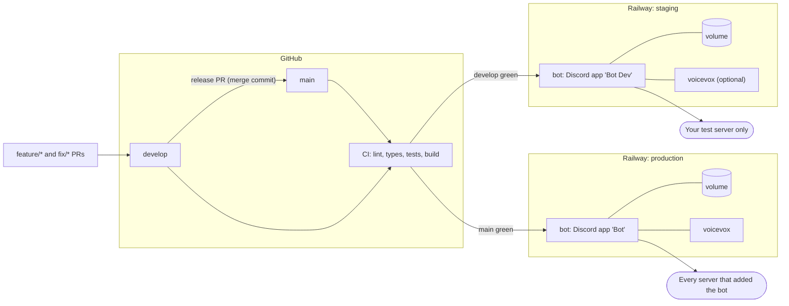
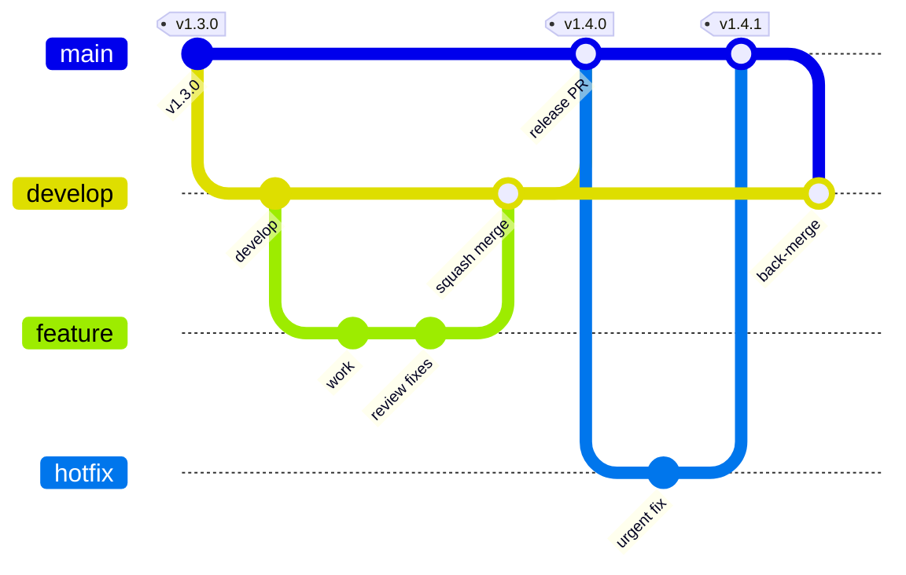

# Operations

How the bot runs in two environments - **staging** for your own test server,
**production** for every server - and how a change travels from a branch to
both. First-time setup of a single Railway service is in
[deployment.md](deployment.md); this page builds on it.

## Environments at a glance

|                         | Staging                                    | Production                        |
| ----------------------- | ------------------------------------------ | --------------------------------- |
| Git branch              | `develop`                                  | `main`                            |
| Discord application     | A second app (e.g. "Bot Dev"), private     | The public app                    |
| Servers                 | Your test server only                      | Every server that invites the bot |
| Railway environment     | `staging`                                  | `production`                      |
| `DISCORD_TOKEN` / `_ID` | The dev app's                              | The public app's                  |
| `DISCORD_GUILD_ID`      | Test server ID (commands update instantly) | Unset (global commands)           |
| `ALLOWED_GUILD_IDS`     | Test server ID                             | Unset                             |
| `NODE_ENV`              | `production`                               | `production`                      |
| `LOG_LEVEL`             | `debug`                                    | Unset (`info`)                    |
| `ALERT_WEBHOOK_URL`     | A test channel's webhook, or unset         | The ops channel's webhook         |
| `VOICEVOX_URL`          | Its own engine, or unset when not testing  | Its own engine                    |
| Volume (`/app/data`)    | Its own                                    | Its own                           |

Staging runs with `NODE_ENV=production` so it behaves exactly like
production; `LOG_LEVEL=debug` is the only intended difference in behavior.

## Why two Discord applications

One application is one bot user with one token. Running the same token in
two places - staging and production - does not give you two bots; it gives
one bot driven by two processes:

- **Both processes receive every event.** Each answers every slash command;
  the slower one fails with "interaction has already been acknowledged", so
  users see random errors from whichever version lost the race.
- **Voice breaks.** Discord allows one voice connection per server per bot
  user, so the two processes keep taking the connection from each other.
- **Commands are overwritten.** Whichever process starts last registers its
  command list, so a staging deploy can publish unreleased commands to every
  server.

A second application costs nothing and gives staging its own token, its own
command list and its own intent settings, and appears in your server as a
separate member.

`ALLOWED_GUILD_IDS` and the private application are two locks on the same
door. The private application keeps anyone else from inviting the staging
bot; `ALLOWED_GUILD_IDS` makes it leave any server it joins anyway, and
refuse commands in any server it was already in.

## One-time setup

### 1. Create the staging Discord application

1. In the [Developer Portal](https://discord.com/developers/applications),
   create a new application, e.g. "Bot Dev".
2. **Installation → Install Link**: set to **None**. Discord refuses to make an
   application private while it still has an install link.
3. **Bot → Public Bot**: turn **off**. Only you can add it to servers now.
4. **Bot → Privileged Gateway Intents**: turn on **Server Members Intent**,
   and **Message Content Intent** if staging will run text-to-speech - the same
   as production.
5. **Bot → Reset Token**: copy the token for Railway. Copy the **Application
   ID** from General Information.
6. **OAuth2 → URL Generator**: scopes `bot` and `applications.commands`, the
   same permissions production uses; open the URL and add the bot to your test
   server.

Prefer a test server the production bot is **not** in. If the two bots share
a server, every command appears twice (Discord labels each with its app), and
both bots auto-join the same voice channels unless you turn auto-join off for
the staging bot there with `/voice autojoin disable`.

For running the bot on your own machine, either create a third application
for local use, or stop the staging deployment first (Railway → the bot
service → **Deployments** → **⋯ → Remove**): a local process on the staging
token is the same one-bot-two-processes problem.

### 2. Create the Railway staging environment

The existing environment is production; keep it on `main`.

1. In the project, open the environment menu → **New Environment** →
   **Duplicate Environment** from `production`, named `staging`. Railway copies
   every service, variable and setting, and **stages** the result instead of
   deploying it.
2. **Before you approve the staged changes**, open the bot service in
   `staging` → **Variables** and change, at minimum:

   | Variable            | Set to                                           |
   | ------------------- | ------------------------------------------------ |
   | `DISCORD_TOKEN`     | The dev app's token                              |
   | `DISCORD_CLIENT_ID` | The dev app's Application ID                     |
   | `DISCORD_GUILD_ID`  | Your test server's ID                            |
   | `ALLOWED_GUILD_IDS` | Your test server's ID                            |
   | `LOG_LEVEL`         | `debug`                                          |
   | `ALERT_WEBHOOK_URL` | A test channel's webhook, or delete the variable |

   A duplicated environment keeps the **production token** until you change
   it. Approving with it would start a second process on the production bot -
   every problem in [Why two Discord applications](#why-two-discord-applications)
   at once.

3. **Settings → Source** on the bot service: set the trigger branch to
   **`develop`**, and enable **Wait for CI** (CI runs on pushes to `develop`).
4. Check **Settings → Volumes**: staging has its own volume mounted at
   `/app/data`. Staging must never share production's data.
5. VOICEVOX: private networking does not cross environments, so staging needs
   its own engine service (the duplicate includes one). To save resources,
   remove it and delete `VOICEVOX_URL` in staging while you are not working on
   text-to-speech.
6. Approve the staged changes. The first log lines should read
   `Registered N commands to guild <test server>` and `Bot is ready!`.

To find a server ID, turn on **User Settings → Advanced → Developer Mode** in
Discord, then right-click the server icon → **Copy Server ID**.

### 3. Keep PR environments off

**Project Settings → Environments → PR Environments** (and **Bot PR
Environments**) should stay **off**. A PR environment copies its base
environment's variables, token included, so every open pull request would
start another process on the staging bot. Test pull requests by merging to
`develop`, or locally with your own `.env`.

### 4. Protect the branches

In GitHub, **Settings → Rules** (or **Branches**):

| Branch    | Rules                                                                                                                                                                                 |
| --------- | ------------------------------------------------------------------------------------------------------------------------------------------------------------------------------------- |
| `main`    | Require a pull request; require the status check **Lint, Type Check, Test & Build**; block force pushes and deletion. Do **not** require linear history - releases are merge commits. |
| `develop` | Require a pull request and the same status check; block force pushes.                                                                                                                 |

In **Settings → General → Pull Requests**, allow both **merge commits** (for
releases) and **squash merging** (for feature PRs).

## Day to day

### A change

1. Branch from `develop`: `feature/<name>` or `fix/<name>`.
2. Open a pull request to `develop`. The template asks for what changed, how
   it was tested, and whether it touches the database, intents, permissions
   or environment variables.
3. When CI is green and the review is done, **squash merge**.
4. Railway deploys `develop` to staging once CI on `develop` passes. Try the
   change in your test server.

### A release

1. Open a pull request from `develop` to `main` with the release template:
   `https://github.com/iam74k4/Bot-Discord/compare/main...develop?template=release.md`
2. Bump `version` in `package.json` on `develop` first, following
   [Semantic Versioning](https://semver.org/), so it matches the tag you will
   push.
3. Work through the template's checklist - it exists because the risky parts
   of a release (new migrations, new intents, new variables) are invisible in
   a diff of hundreds of files.
4. Merge with a **merge commit**, never squash. A squash gives `main` a commit
   `develop` does not have, and every later release PR then shows that
   history again as changes and conflicts.
5. Railway deploys `main` to production after CI passes. Watch the deploy
   logs for `Bot is ready!`, and for no `Config:` warnings you did not expect.
6. Tag the merge commit: `git tag v1.4.0 && git push origin v1.4.0`. The
   Release workflow builds and publishes the GitHub Release.

Add any new environment variable to **both** Railway environments before the
release reaches them; config validation stops a bot whose required variable
is missing or malformed at startup.

### A hotfix

For a production bug that cannot wait for the next release:

1. Branch `hotfix/<name>` from `main`, fix, open a pull request to `main`.
2. Merge it (squash is fine here), let production deploy, tag a patch version.
3. Merge `main` back into `develop` with a pull request (a **merge commit**),
   so the fix is not lost - or reintroduced - by the next release.

## Rolling back

Every redeploy of a service with a volume stops the old deployment before the
new one starts - Railway never runs two deployments on one volume - and the
old one's graceful shutdown takes a final backup (`SHUTDOWN_FINAL_BACKUP`,
on by default). So a backup from just before each release's migrations
already exists in `data/backups/`; `/owner system` → **Backups** lists them
and takes one on demand.

1. **Code rollback**: Railway → the bot service → **Deployments** → the last
   good deployment → **⋯ → Rollback**. This restores the image and the
   variables, **not** the volume.
2. That is enough when the release's migrations only **added** tables or
   columns: older code ignores what it does not know about.
3. When a migration **dropped or rewrote** data (as `010_native_polls.ts` did),
   older code cannot run against the new schema. Fix forward with a new
   release instead, or roll the code back **and** restore the pre-release
   backup (below). Say which in the release PR before merging such a release.

### Restoring a backup

Replacing `data/bot.db` under a running bot corrupts it, so the bot restores
at startup, before it opens the database:

1. Find the backup's filename in `/owner system` → **Backups** (for example
   `backup-2026-10-25T04-00-00-a1b2c3.db`).
2. Set `RESTORE_BACKUP` to that filename on the bot service in Railway and
   redeploy (changing a variable redeploys).
3. The deploy log says
   `Restored the database from <file>. The database it replaced is saved as <other file>; restore that to undo.`
4. Delete `RESTORE_BACKUP`. Leaving it set is harmless - the same backup is
   never restored twice - but the next restore should be a deliberate change.

The backup has to pass SQLite's integrity check first. If it does not, or the
file is missing, nothing is touched: the bot starts on the current database,
logs the reason as an error and sends it to the alert webhook. The replaced
database is kept as an ordinary backup, so it is listed in the panel and
pruned by `BACKUP_RETENTION_DAYS` like the others; undoing a restore is
restoring that file.

Revert the change on `develop` (and `main`) too, or the next deploy brings it
back.

## Routine checks

- **After every production deploy**: the logs show `Logged in as`,
  `Serving N guilds`, `Bot is ready!`; the alert channel is quiet.
- **Weekly**: `/owner system` - memory, feature health, latest backup time.
  Dependabot and the weekly CodeQL run open their own pull requests and alerts.
- **When a token leaks**: Developer Portal → Bot → **Reset Token**, then update
  `DISCORD_TOKEN` in that environment only. Tokens live in Railway variables,
  never in the repository.

[← Back to README](../README.md)
